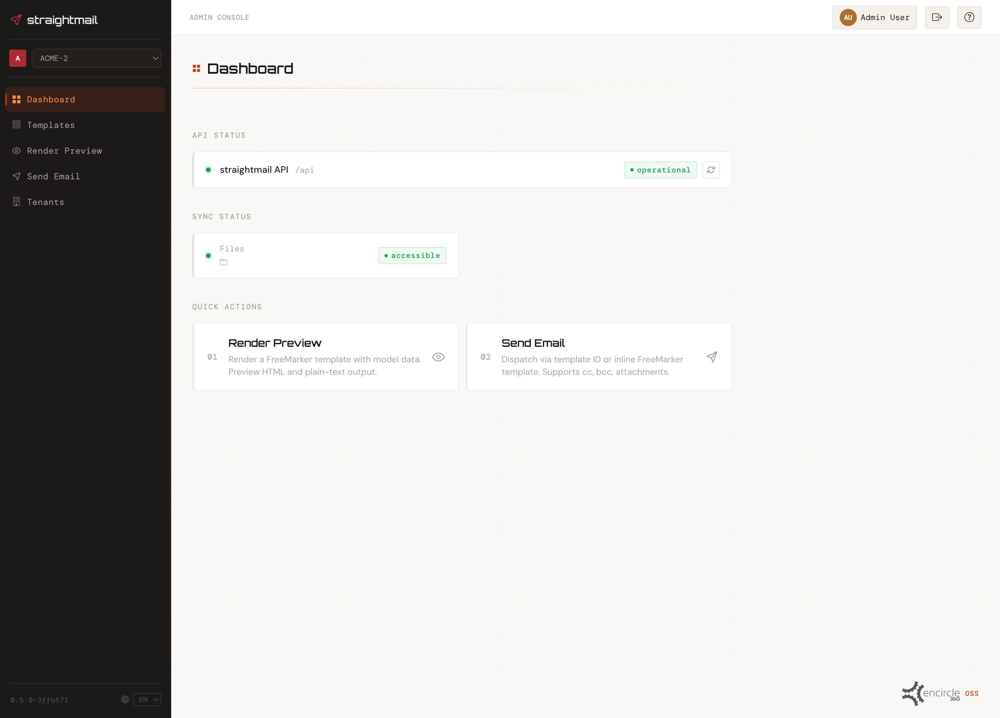
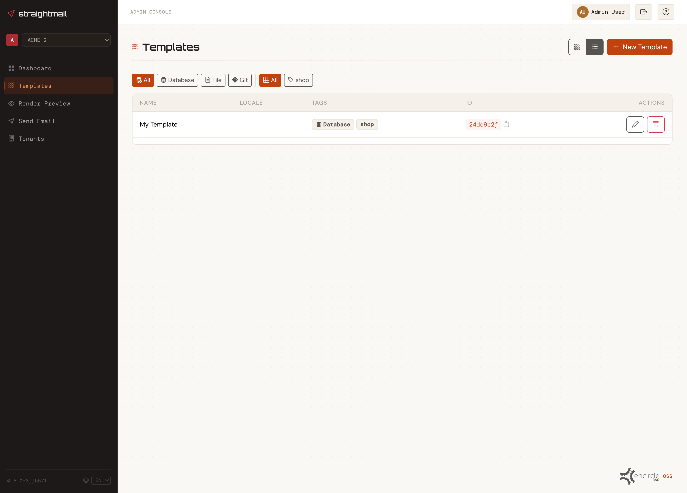
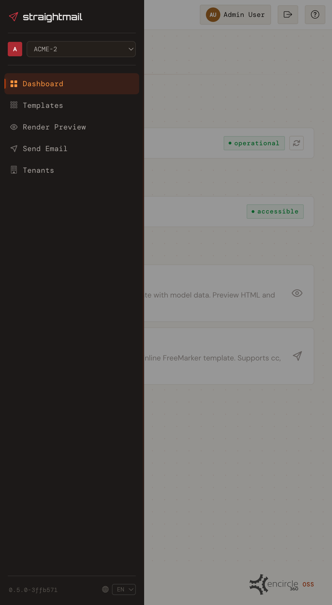
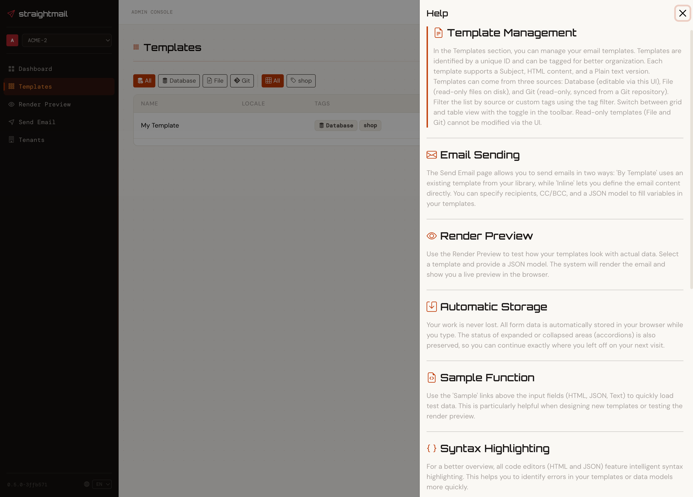
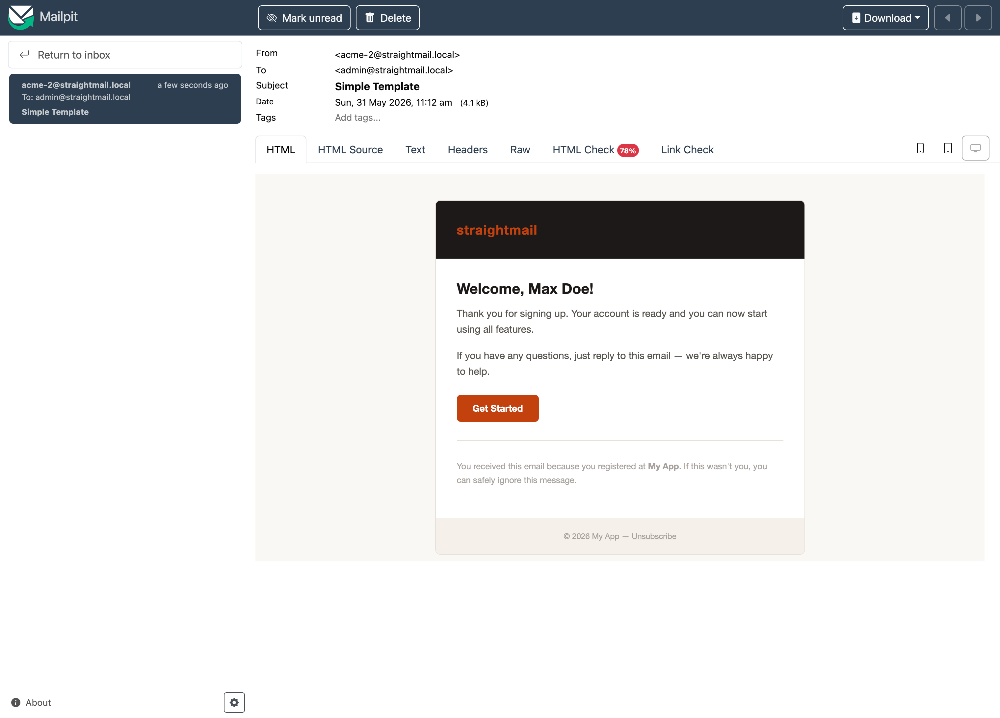

#  straightmail

[](../../actions/workflows/monorepo.yml)
[](../../actions/workflows/backend.yml)
[](../../actions/workflows/frontend.yml)
[](../../pkgs/container/straightmail)

[](LICENSE)
[](https://www.oracle.com/java/)
[](https://spring.io/projects/spring-boot)
[](https://angular.io)
[](https://matrix.to/#/#oss:encircle360.com)

**straightmail** is a mail sending API with template and i18n support, combined with a modern Angular administration
console for managing email templates, rendering, and sending operations.



<table width="800">
  <tr>
    <td valign="top" width="25%" align="center">
      
      <br><sub>Templates</sub>
    </td>
    <td valign="top" width="25%" align="center">
      
      <br><sub>Edit Template</sub>
    </td>
    <td valign="top" width="25%" align="center">
      
      <br><sub>Render Preview</sub>
    </td>
    <td valign="top" width="25%" rowspan="2" align="center" valign="top">
      
      <br><sub>Mobile View</sub>
    </td>
  </tr>
  <tr>
    <td valign="top" width="25%" align="center">
      
      <br><sub>Send Mail</sub>
    </td>
    <td valign="top" width="25%" align="center">
      
      <br><sub>Help Panel</sub>
    </td>
    <td valign="top" width="25%" align="center">
      
      <br><sub>Mail Output</sub>
    </td>
  </tr>
</table>

## straightmail Monorepo

This repository contains the straightmail backend and admin frontend as a monorepo.

```
straightmail/
├── backend/          # Spring Boot Application (Java 25)
├── frontend/         # Angular Admin Frontend
├── docker/           # Mode-specific Docker Compose stacks
├── .github/workflows # CI/CD pipelines
└── README.md
```

## Getting Started

### Migrating from 0.4.x

If you're upgrading straightmail from 0.4.0 or 0.4.1, check this migration guide first:

<details>
<summary><strong>Migration Guide</strong></summary>

### What changed

|                     | 0.4.x                                             | 0.5.0                                                                                                                  |
|---------------------|---------------------------------------------------|------------------------------------------------------------------------------------------------------------------------|
| API paths           | `POST /email`, `/email/inline`, `/render`         | **`POST /api/v1/email`, `/api/v1/email/inline`, `/api/v1/render`** — the old paths answer `403`                        |
| Authentication      | none                                              | **`AUTH_MODE` defaults to `oidc`** — without `AUTH_MODE: none` and without a reachable OIDC issuer the app does not start |
| `ENCRYPTION_KEY`    | not used                                          | **required** — Base64 of exactly 32 bytes (`openssl rand -base64 32`), otherwise the app does not start                |
| API docs            | `/v3/api-docs`                                    | `/api/v3/api-docs` (`/v3/api-docs` answers `404`); Swagger UI stays at `/swagger-ui/index.html`                        |
| Derived plain text  | links rendered as `text ( url )`                  | links rendered as `text(url)`; whitespace can differ — affects mails without `_plain.ftl`                              |
| Container image     | `ghcr.io/encircle360-oss/straightmail`            | same image, still backend only; the Admin UI ships only in `…/straightmail/monorepo` — see [Images](#images)           |
| Base image          | `eclipse-temurin:21-jre`, runs as root            | Temurin 25 JRE, runs as user `straightmail` (UID 10001), application in `/app` instead of `/straightmail.jar`          |
| FreeMarker          | unrestricted                                      | **sandboxed** — `?new`, `?api` and the Spring form-binding macros fail                                                 |
| Template paths      | resolved as given                                 | confined to the template root — a `templateId` that escapes it is not found                                            |
| Actuator (`:50004`) | framework default                                 | only `health` (with the `liveness` and `readiness` groups); widen via `MANAGEMENT_ENDPOINTS`                            |
| Security headers    | none beyond Spring defaults                       | CSP, `Referrer-Policy`, HSTS on every filter chain                                                                     |

Your existing `SMTP_HOST`, `SMTP_PORT`, `SMTP_USER`, `SMTP_PASSWORD`, `SMTP_ENABLE_TLS`,
`SMTP_ENABLE_SSL`, and `DEFAULT_SENDER` values carry over unchanged, and `SMTP_PORT` still defaults
to `587`. The request fields (`emailTemplateId`, `sender`, `senderName`, `model`, `locale`,
`attachments`, …) are unchanged; only the paths moved.

The prefix `/api` comes from `API_PREFIX`; `/v1` is fixed. Requests to the 0.4.x paths are not API
requests any more and are rejected by CSRF protection with `403`.

---

### Without Admin UI — API-only (minimal)

This is the shortest path for a 0.4.x setup: file templates, no database, no authentication.

```yaml
services:
  straightmail:
    image: ghcr.io/encircle360-oss/straightmail:0.5.0
    ports:
      - "50003:50003"
    environment:
      AUTH_MODE: none                                 # new — the default is oidc
      ENCRYPTION_KEY: "<openssl rand -base64 32>"     # new — required
      SMTP_HOST: <your-mail-server>
      SMTP_PORT: <port>
      SMTP_USER: <username>
      SMTP_PASSWORD: <password>
      DEFAULT_SENDER: <noreply@example.com>
      SMTP_ENABLE_TLS: "true"
      SMTP_ENABLE_SSL: "false"
```

Then point your clients at `/api/v1/email`, `/api/v1/email/inline` and `/api/v1/render`. No tenant
has to be declared in this mode — see [Tenants and SMTP](#tenants-and-smtp).

---

### With Admin UI

The Admin UI is only contained in `ghcr.io/encircle360-oss/straightmail/monorepo`. That image
carries version tags from the release after 0.5.0 on; 0.5.0 is published there only as the commit
tag `0397766` and, until the next release, as `latest` — see [Images](#images). It is served at
`http://localhost:50003`.
Activate the `database` Spring profile to enable template CRUD and tenant management. The SQLite
file lives on a named volume so the non-root process can write to it.

**Option A — API-Key auth (recommended for quick migration)**

```yaml
services:
  straightmail:
    image: ghcr.io/encircle360-oss/straightmail/monorepo:latest
    ports:
      - "50003:50003"
    volumes:
      - straightmail-data:/data
    environment:
      SPRING_PROFILES_ACTIVE: database
      DB_URL: "jdbc:sqlite:/data/straightmail.db?journal_mode=WAL"
      AUTH_MODE: api-key
      API_KEY: "<your-secure-api-key>"
      ENCRYPTION_KEY: "<openssl rand -base64 32>"
      SMTP_HOST: <your-mail-server>
      SMTP_PORT: <port>
      SMTP_USER: <username>
      SMTP_PASSWORD: <password>
      DEFAULT_SENDER: <noreply@example.com>
      SMTP_ENABLE_TLS: "true"
      SMTP_ENABLE_SSL: "false"

volumes:
  straightmail-data:
```

Access the UI at `http://localhost:50003`. Send API requests with `X-API-KEY: <your-secure-api-key>`
and `X-Tenant-ID: default` — the global key carries no tenant, and a request without `X-Tenant-ID`
answers `400`.

**Option B — OIDC auth (production)**

```yaml
services:
  straightmail:
    image: ghcr.io/encircle360-oss/straightmail/monorepo:latest
    ports:
      - "50003:50003"
    volumes:
      - straightmail-data:/data
    environment:
      SPRING_PROFILES_ACTIVE: database
      DB_URL: "jdbc:sqlite:/data/straightmail.db?journal_mode=WAL"
      AUTH_MODE: oidc
      OIDC_ISSUER_URI: https://<your-keycloak>/realms/<realm>
      ENCRYPTION_KEY: "<openssl rand -base64 32>"
      SMTP_HOST: <your-mail-server>
      SMTP_PORT: <port>
      SMTP_USER: <username>
      SMTP_PASSWORD: <password>
      DEFAULT_SENDER: <noreply@example.com>
      SMTP_ENABLE_TLS: "true"
      SMTP_ENABLE_SSL: "false"

volumes:
  straightmail-data:
```

The issuer must be reachable from the container at startup; if the container can only reach your
identity provider under an internal name, set `OIDC_JWK_URI` to the internal JWK set URL. Tokens
must carry the audience `straightmail` (`OIDC_AUDIENCE`) and a tenant claim (`tenant_id` or
`tenant_ids`) — see [Authentication](#authentication).

For a SQLite setup with Keycloak, see [`docker/oidc-sqlite.yml`](docker/oidc-sqlite.yml); for
PostgreSQL, see [`docker/oidc-postgres.yml`](docker/oidc-postgres.yml). Both are local development
stacks — [`docker/README.md`](docker/README.md) lists what a real deployment has to change.

---

### Templates and translations

In 0.4.x, templates and translations were typically baked into a custom image:

```dockerfile
FROM ghcr.io/encircle360-oss/straightmail:0.4.1
ADD templates /resources/templates
ADD i18n /resources/i18n
```

The same Dockerfile works with `FROM ghcr.io/encircle360-oss/straightmail:0.5.0`, and so does
mounting the two directories as volumes. What 0.5.0 does with the files depends on their layout.

**Flat layout (0.4.x)** — `/resources/templates/<id>.ftl`. In single-tenant operation — no
`database` profile and at most one tenant declared in `tenants.config` — `POST /api/v1/email` still
finds these templates: when no template source knows the ID, it falls back to the 0.4.x lookup, first
`classpath:templates/<id>.ftl`, then `/resources/templates/<id>.ftl`. Once several tenants are declared
or the `database` profile is active, the flat layout is not served: an ID no template source knows
answers `400` (template not found). `POST /api/v1/render` and the template listing
(`GET /api/v1/templates`) never use this fallback and answer `404` / list nothing.

**Tenant layout** — `<TEMPLATE_FILE_PATH>/<tenant>/<id>.ftl`, read by the file template source,
which is enabled by default. All endpoints see these templates. Set `TEMPLATE_FILE_PATH`: its
default `/directory/files/templates` does not exist in the image.

```
templates/
└── default/
    ├── welcome.ftl
    ├── welcome_subject.ftl
    └── welcome_plain.ftl     # optional
```

```yaml
    volumes:
      - ./templates:/templates:ro
    environment:
      TEMPLATE_FILE_PATH: /templates
```

The directory name is the tenant ID; without authentication that is `default` (`TENANTS_DEFAULT_ID`).
Subdirectories are supported — `default/emails/welcome.ftl` gets the template ID `emails/welcome`.
A request resolves templates only in its own tenant's folder; with several tenants declared, a
template ID that names another tenant's folder answers `400` like any unknown template, wherever the
tenant layout lives.

**Includes do not follow the tenant layout.** `<#include>` and `<#import>` resolve through
`spring.freemarker.template-loader-path` — `file:/resources/templates`, then `classpath:templates` —
not through the tenant directory. If you move templates that include other files into the tenant
layout, keep the included files under `/resources/templates` as well, or point the loader path at
the new location (environment variable `SPRING_FREEMARKER_TEMPLATELOADERPATH`, comma-separated).

**Template IDs cannot leave the template root.** A `templateId` that resolves outside its tenant
folder (tenant layout) or outside `/resources/templates` (flat layout) is not read: `/api/v1/render`
answers `404`, `/api/v1/email` answers `400`. A `../` that normalises back
inside the same folder still resolves.

**Translations.** Message bundles (`messages.properties`, `messages_de.properties`, …) are read from
`I18N_PATH` (default `/resources/i18n`) first; the built-in bundles answer every key that directory
does not define. A missing directory is skipped.

---

### Sandboxed template rendering

**⚠️ Breaking change — this one fails at render time, not at startup.** Tenants author their own
templates, so FreeMarker now runs with `TemplateClassResolver.ALLOWS_NOTHING_RESOLVER` and the
`?api` built-in disabled. Two built-ins stop working:

| Built-in | 0.4.x                                   | 0.5.0                    |
|----------|-----------------------------------------|--------------------------|
| `?new`   | instantiated any class on the classpath | rejected for every class |
| `?api`   | exposed the underlying Java API         | disabled                 |

A template that still uses them fails the request and logs:

```
freemarker.core._MiscTemplateException: Instantiating freemarker.template.utility.Execute
is not allowed in the template for security reasons.
```

Templates also no longer see Spring's `RequestContext`: `springMacroRequestContext` only offers
message and URL lookups, so `<@spring.message>` keeps working while the form-binding macros
(`spring.bind`, `spring.formInput`, …) fail.

Check your templates before upgrading:

```bash
rg -n '\?new|\?api|spring\.bind|spring\.form' templates/
```

The background: `?new` could instantiate `freemarker.template.utility.Execute`, which runs OS
commands — reachable by any caller holding a per-tenant API key, and enough to read `ENCRYPTION_KEY`
out of the process environment. There is no opt-out flag, and there is deliberately no config to
re-enable it. Templates that need Java behaviour must get it from the model passed into the render.

---

### Tenants and SMTP

Without the `database` profile, tenants are declared statically in `tenants.config`:

**YAML form** (e.g. mounted `application.yml`):

```yaml
tenants:
  config:
    - id: default
      displayName: Default
```

**Env var form** (Docker Compose `environment:`):

```yaml
environment:
  TENANTS_CONFIG_0_ID: default
  TENANTS_CONFIG_0_DISPLAY_NAME: Default
```

Whether you need an entry depends on the auth mode:

- **`none`** — a request without `X-Tenant-ID` uses the default tenant (`TENANTS_DEFAULT_ID`,
  default `default`) without any check, so no entry is needed. A request that sends `X-Tenant-ID`
  must name a declared tenant, otherwise it answers `404`.
- **`api-key`** and **`oidc`** — the tenant from `X-Tenant-ID` or from the JWT claim must be declared,
  otherwise the request answers `404`.

Declaring a tenant also changes how its mail is sent. For a tenant without an entry, straightmail
uses Spring Boot's mail sender built from the global `SMTP_*` variables, as 0.4.x did. For a tenant
with an entry, straightmail builds the sender itself: from the entry's own `smtpHost`, `smtpPort`,
`smtpUser`, `smtpPassword`, `smtpTls`, `smtpSsl` when the entry sets `smtpHost`, otherwise from the
global `SMTP_*` values as a whole. That sender announces SMTP AUTH only when a username is set,
always uses SSL on port 465, and applies no `spring.mail.properties.*` other than the TLS and SSL
flags. An entry's `smtpSender` overrides the `sender` of every request.

> With the `database` profile active, tenants live in the database. The schema migration creates
> the `default` tenant, and `TenantReconciliationService` creates every `tenants.config` entry whose
> tenant does not exist yet. Existing tenants — `default` included — are not updated from the config;
> change them through the API or the Admin UI.

---

### Security defaults in 0.5.0

Four defaults changed in ways an existing integration can notice.

**Tenant reads are admin-only.** `GET /api/v1/tenants` and `GET /api/v1/tenants/{slug}` answer `403`
unless the caller holds `ROLE_ADMIN`. In OIDC mode that role comes from `realm_access.roles`, so the
Admin UI's tenant pages stay empty until your identity provider actually issues it. In API-key mode
the global `API_KEY` counts as admin while a per-tenant key does not. `GET /api/v1/tenants/me` returns
the caller's own tenants — scripts that only need their own tenant should use it.

**Actuator exposes `health` only.** `/actuator/info`, `/actuator/metrics` and everything else on
`:50004` answer `404`. Set `MANAGEMENT_ENDPOINTS` to a comma-separated list to widen it again — but
note the management port carries no authentication of its own, so it does not belong on a public interface.
`/actuator/health/liveness` and `/actuator/health/readiness` are available for container probes.

**Every response carries security headers.** All three filter chains send a Content-Security-Policy,
`Referrer-Policy: same-origin` and HSTS. The policy is derived from the deployment: the configured
`auth.issuer-uri` is added to `connect-src`, `frame-src` and `form-action`. If your identity provider,
CDN or asset host lives somewhere else, replace the policy wholesale:

```yaml
environment:
  SECURITY_CONTENT_SECURITY_POLICY: "default-src 'self'; script-src 'self'; connect-src 'self' https://idp.example.com"
```

`script-src` is strict — the Admin UI ships without `unsafe-eval` and runs NGXS in its
CSP-compatible mode. Weakening it defeats the reason the header is there.

**Template previews and remote images.** The Admin UI shows a rendered template in an
`<iframe srcdoc>`, and an `about:srcdoc` document inherits the policy of the page that embeds it —
so the header above governs the preview as well. With the shipped default, every image a template
pulls from a foreign host is blocked and the browser console reports a violation of
`img-src 'self' data: https://www.gravatar.com`. A `<meta http-equiv>` inside the previewed HTML
cannot repair that: an inherited policy can only be tightened, never widened, and `blob:` URLs
inherit it too. If your templates reference remote images, widen `img-src` through the override —
and carry the rest of the policy along, identity provider origin included, because the override
replaces the generated one completely:

```yaml
environment:
  SECURITY_CONTENT_SECURITY_POLICY: >-
    default-src 'self';
    script-src 'self';
    style-src 'self' 'unsafe-inline' https://fonts.googleapis.com;
    font-src 'self' https://fonts.gstatic.com data:;
    img-src 'self' data: https:;
    connect-src 'self' https://idp.example.com;
    frame-src 'self' https://idp.example.com;
    form-action 'self' https://idp.example.com;
    frame-ancestors 'none';
    base-uri 'self';
    object-src 'none'
```

That widens image loading to any HTTPS host and leaves every other directive as it was. Unrelated
to the policy, the preview iframe is sandboxed without `allow-scripts`, so scripts inside a template
never execute — the console message saying so is expected, not a misconfiguration.

**HSTS behind a TLS terminator.** `server.forward-headers-strategy` is set to `framework`, so Spring
Security recognises HTTPS from the `X-Forwarded-*` headers your proxy sends. Without a TLS terminator
in front, HSTS is not emitted at all.

For the rest of the deployment hardening — profiles, credentials, port exposure — see
[`docker/README.md`](docker/README.md).

</details>

### Local Development

**Prerequisites:** JDK 25 (Temurin), Node.js 22.22+, 24.15+ or 26 (CI uses 26), Docker. The Gradle
wrapper (9.9.2) is in the repo.

**One-time setup — backend local config:**

The `local` Spring profile reads overrides from `backend/src/main/resources/application-local.yml`,
which is gitignored. Create it from the example and generate an encryption key:

```bash
cd backend/src/main/resources
cp application-local.yml.example application-local.yml

# Generate a random AES-256 key and paste it into the `encryption.key` value
openssl rand -base64 32
```

Open `application-local.yml` and replace `encryption.key: CHANGE_ME_GENERATE_RANDOM_KEY`
with the generated value. Adjust SMTP, auth, and tenant settings as needed.

**Terminal 1 — Backend:**

```bash
cd backend
SPRING_PROFILES_ACTIVE=local ./gradlew bootRun
# API available at http://localhost:50003/api/
```

Nothing activates the `local` profile by default; add `database` (`local,database`) for template
CRUD and tenant management. `bootRun` also builds the Admin UI unless `SKIP_FRONTEND_BUILD=true` is set.

**Terminal 2 — Frontend:**

```bash
cd frontend
npm install
npm start
# Dev server at http://localhost:4200 (proxies /api → :50003)
```

### Docker Compose

The `docker/` directory contains four ready-to-use Compose stacks:

| Stack               | Auth            | Database   | Templates                  |
|---------------------|-----------------|------------|----------------------------|
| `minimal.yml`       | None (open)     | —          | File + Git-sync            |
| `apikey-sqlite.yml` | API-Key         | SQLite     | File + Git-sync + Database |
| `oidc-sqlite.yml`   | OIDC / Keycloak | SQLite     | File + Git-sync + Database |
| `oidc-postgres.yml` | OIDC / Keycloak | PostgreSQL | File + Git-sync + Database |

All four stacks publish their ports on `127.0.0.1` and ship development credentials. They are meant
for local work only — [`docker/README.md`](docker/README.md) lists what a real deployment has to change.

**Prerequisite:** Build the backend JAR first — the stacks build their image from it:

```bash
cd backend && ./gradlew bootJar
```

`bootJar` embeds the Admin UI unless `SKIP_FRONTEND_BUILD=true` is set.

Start a stack (example — OIDC + SQLite):

```bash
cd docker && docker compose -f oidc-sqlite.yml up
```

> **Encryption key:** Each stack sets `services.backend.environment.ENCRYPTION_KEY`
> in its compose file. The value is a development key — generate a real 32-byte key
> with `openssl rand -base64 32` and replace it before any shared or production use.
> See [docker/README.md → Encryption Key](docker/README.md#encryption-key).

See [docker/README.md](docker/README.md) for detailed configuration per stack.

### Full Production Build (Backend serves Frontend)

```bash
cd backend
./gradlew build
# Angular is built and embedded into the Spring Boot JAR
```

Skip the Angular build (backend-only):

```bash
SKIP_FRONTEND_BUILD=true ./gradlew build
```

### Images

| Image                                           | Contents                    | Commit tag from the default branch |
|-------------------------------------------------|-----------------------------|------------------------------------|
| `ghcr.io/encircle360-oss/straightmail`          | backend only, no Admin UI   | `master-<sha>`                     |
| `ghcr.io/encircle360-oss/straightmail/monorepo` | backend with the Admin UI   | `<sha>` (7 characters)             |

Both images are tagged by the same rules:

- A release tag `vX.Y.Z` publishes `X.Y.Z`, `X.Y`, `X` and `latest`, so `latest` is the most
  recently tagged release.
- A pre-release tag such as `v1.0.0-rc.1` publishes only `1.0.0-rc.1`.
- Every push to the default branch publishes `edge` and the commit tag above; these builds are
  unreleased and never become `latest`.

The Admin UI image gets version tags starting with the release after 0.5.0. 0.5.0 is published
there only as the commit tag `0397766` and, until the next release, as `latest`.

Both are multi-arch (`linux/amd64`, `linux/arm64`) and carry an SBOM and build provenance.

## CI / CD

GitHub Actions build and test every pull request, publish both images as `edge` on every push to
the default branch, and publish both under their version and `latest` on every `v*.*.*` tag.
Dependency updates come from Dependabot. See [`.github/workflows/README.md`](.github/workflows/README.md)
for each workflow, its triggers and its required permissions.

## Template Sources

straightmail supports three template sources that can be combined:

| Source   | Description                                                     | Enabled                                         |
|----------|-----------------------------------------------------------------|-------------------------------------------------|
| Database | Templates stored in SQLite / PostgreSQL (full CRUD via UI/API)  | only with the `database` profile                |
| File     | Read-only `.ftl` files from a directory per tenant              | by default (`TEMPLATE_FILE_ENABLED=true`)       |
| Git-sync | Templates cloned from a per-tenant Git repository on a schedule | by default (`TEMPLATE_GIT_SYNC_ENABLED=true`)   |

In single-tenant operation (no `database` profile, at most one declared tenant) `POST /api/v1/email`
additionally falls back to the 0.4.x flat layout under `/resources/templates` — see
[Templates and translations](#templates-and-translations).

### File Templates

Place FreeMarker templates in one directory per tenant below `TEMPLATE_FILE_PATH`. The Compose stacks
mount `docker/data/files` there.

```
templates/
├── acme-1/
│   ├── welcome.ftl           # HTML body
│   ├── welcome_subject.ftl   # Subject line
│   └── welcome_plain.ftl     # Plain-text body (optional)
└── acme-2/
    └── ...
```

| Environment variable    | Default                     | Description                                                       |
|-------------------------|-----------------------------|-------------------------------------------------------------------|
| `TEMPLATE_FILE_ENABLED` | `true`                      | Enable the file template source                                   |
| `TEMPLATE_FILE_PATH`    | `/directory/files/templates` | Root directory with one sub-directory per tenant; set it — the default does not exist in the image |

### Git-Sync Templates

When enabled, the backend clones a Git repository per tenant at startup and on a schedule, and loads
`.ftl` files from the working tree. With the `database` profile the repository URL and optional
access token are configured per tenant via the UI or API (stored encrypted in the database); without
it they come from `gitRepoUrl`, `gitToken` and `gitBranches` in `tenants.config`.

| Environment variable          | Default                    | Description                                                    |
|-------------------------------|----------------------------|----------------------------------------------------------------|
| `TEMPLATE_GIT_SYNC_ENABLED`   | `true`                     | Enable the Git-sync template source                            |
| `TEMPLATE_GIT_SYNC_BASE_PATH` | `/directory/git/templates` | Working copies; the image prepares a writable `/git`           |
| `TEMPLATE_GIT_SYNC_CRON`      | `0 0 * * * *`              | Cron expression for the sync job (hourly by default)           |
| `TEMPLATE_GIT_SYNC_LOCK_MIN`  | `PT1M`                     | Minimum lock duration (ShedLock, `database` profile)           |
| `TEMPLATE_GIT_SYNC_LOCK_MAX`  | `PT2M`                     | Maximum lock duration (ShedLock, `database` profile)           |

Both sources are enabled in all Docker Compose variants. To disable one, set the corresponding variable to `"false"`.

## Authentication

straightmail supports three authentication modes configured at startup:

| Mode       | `AUTH_MODE` value | Description                                                                                                                                                                  |
|------------|-------------------|------------------------------------------------------------------------------------------------------------------------------------------------------------------------------|
| OIDC / JWT | `oidc` (default)  | JWT from an OIDC provider (e.g. Keycloak). Roles are derived from `realm_access.roles` → `ROLE_*`. The tenant is resolved from a JWT claim; a token without one gets `403`. |
| API-Key    | `api-key`         | `X-API-KEY` header with the global `API_KEY` or a per-tenant key (stored as a SHA-256 hash, `database` profile only). The global key needs `X-Tenant-ID`.                     |
| None       | `none`            | All endpoints are open. Suitable for internal services with network-level protection.                                                                                       |

Key environment variables:

| Variable               | Default                                   | Description                                                              |
|------------------------|-------------------------------------------|--------------------------------------------------------------------------|
| `AUTH_MODE`            | `oidc`                                    | Authentication mode: `oidc`, `api-key`, or `none`                        |
| `OIDC_ISSUER_URI`      | `http://localhost:8090/realms/straightmail` | Issuer the `iss` claim must match; discovered at startup unless `OIDC_JWK_URI` is set |
| `OIDC_JWK_URI`         | —                                         | JWK set URL to use instead of discovery (e.g. a container-internal name) |
| `OIDC_AUDIENCE`        | `straightmail`                            | Accepted `aud` values, comma-separated                                   |
| `JWT_TENANT_CLAIM`     | `tenant_id`                               | JWT claim that contains the single tenant ID                             |
| `JWT_TENANT_IDS_CLAIM` | `tenant_ids`                              | JWT claim that contains a list of accessible tenant IDs                  |
| `API_KEY`              | —                                         | Global API key, compared as given; required in `api-key` mode            |

**Roles.** Tenant administration requires `ROLE_ADMIN`: every write in `/api/v1/tenants`, plus the
reads `GET /api/v1/tenants` and `GET /api/v1/tenants/{slug}`. In OIDC mode the role must appear in the
token's `realm_access.roles` — an otherwise valid token without it gets `403` and the Admin UI's tenant
pages stay empty. In API-key mode the global `API_KEY` is admin, a per-tenant key is not. In `none`
mode every caller is admin. `GET /api/v1/tenants/me` is open to any authenticated caller and returns
only their own tenants.

Deployment-level settings:

| Variable                           | Default  | Description                                                                    |
|------------------------------------|----------|--------------------------------------------------------------------------------|
| `ENCRYPTION_KEY`                   | —        | **Required.** AES-256 key, Base64 of exactly 32 bytes (`openssl rand -base64 32`). A missing, non-Base64 or wrong-length value aborts startup |
| `API_PREFIX`                       | `/api`   | Path prefix of every REST endpoint                                             |
| `I18N_PATH`                        | `/resources/i18n` | Directory with external `messages*.properties`, read before the built-in bundles |
| `MANAGEMENT_ENDPOINTS`             | `health` | Comma-separated actuator endpoints exposed on `:50004`                         |
| `SECURITY_CONTENT_SECURITY_POLICY` | derived  | Replaces the generated CSP wholesale; the default adds `auth.issuer-uri` to `connect-src`, `frame-src` and `form-action`. Needed to show remote images in template previews — see [Security defaults in 0.5.0](#security-defaults-in-050) |

## Operation Modes (Spring Profiles)

The backend behaviour is controlled by Spring profiles set via `SPRING_PROFILES_ACTIVE`:

| Profile      | Effect                                                                                                                                                                                                 |
|--------------|--------------------------------------------------------------------------------------------------------------------------------------------------------------------------------------------------------|
| `database`   | Activates database storage for templates and tenants (SQLite by default, `DB_URL`), the template and tenant CRUD APIs, and per-tenant API keys. Without this profile tenants come from `tenants.config`. |
| `production` | Disables Swagger UI and the API docs, tunes the Tomcat thread pool (`max=50`, `min-spare=10`).                                                                                                          |
| `local`      | Reads `application-local.yml` (gitignored) for local development — see [Local Development](#local-development).                                                                                        |

Example — full local stack:

```bash
SPRING_PROFILES_ACTIVE=local,database ./gradlew bootRun
```

## Multi-Tenancy

With the `database` profile, straightmail is fully multi-tenant:

- **Per-tenant SMTP** — Each tenant configures its own SMTP server, credentials, and sender address via the UI or API.
- **Per-tenant Git-sync** — Each tenant can point to an independent Git repository for template storage, synced on a
  configurable cron schedule (ShedLock protected for HA setups).
- **Infrastructure-as-code provisioning** — Tenants declared under `tenants.config.*` are created at startup when they
  do not exist yet (`TenantReconciliationService`); existing tenants are left unchanged. The `default` tenant is
  created by the schema migration and cannot be deleted.
- **Secrets at rest** — SMTP password and Git token are encrypted with AES-256-GCM by `EncryptionService`; per-tenant
  API keys are stored as SHA-256 hashes. Secrets are never returned in plain text by the API.

Without the `database` profile, per-tenant SMTP and Git-sync settings come from `tenants.config` — see
[Tenants and SMTP](#tenants-and-smtp).

## Documentation

- [Backend README](backend/README.md)
- [Frontend README](frontend/README.md)
- API documentation of a running instance: Swagger UI at `http://localhost:50003/swagger-ui/index.html`,
  OpenAPI document at `http://localhost:50003/api/v3/api-docs`

## Ports

| Service     | Port(s)     | Note                                                                                       |
|-------------|-------------|--------------------------------------------------------------------------------------------|
| Backend API | 50003       | serves the API, and the Admin UI when the JAR embeds it                                    |
| Management  | 50004       | actuator, `health` only by default, **no authentication** — keep it internal              |
| Frontend    | 4200        | dev server only                                                                            |
| Keycloak    | 8090        | OIDC Compose stacks                                                                        |
| PostgreSQL  | 5432        | `oidc-postgres.yml`                                                                        |
| Mailpit     | 1025 / 8025 | Compose stacks                                                                             |

## encircle360 OSS Matrix Channel

Join our community for support, discussions, and updates regarding our open-source projects.

[](https://matrix.to/#/#oss:encircle360.com)
