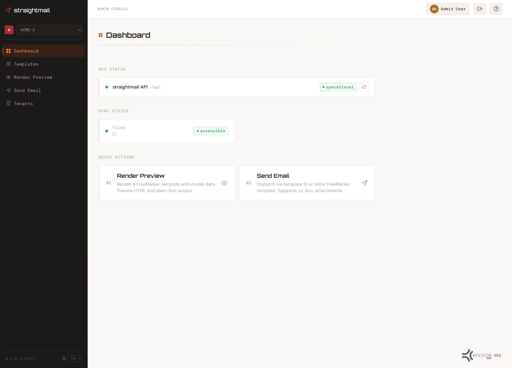
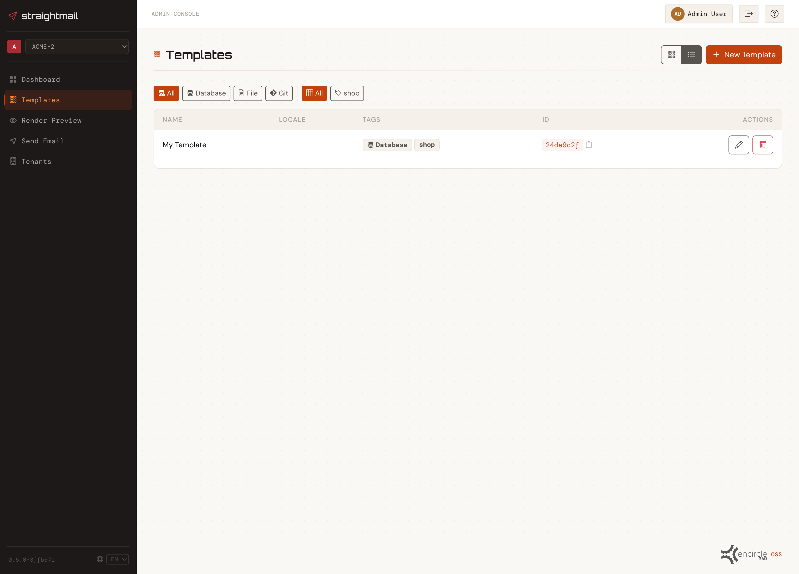
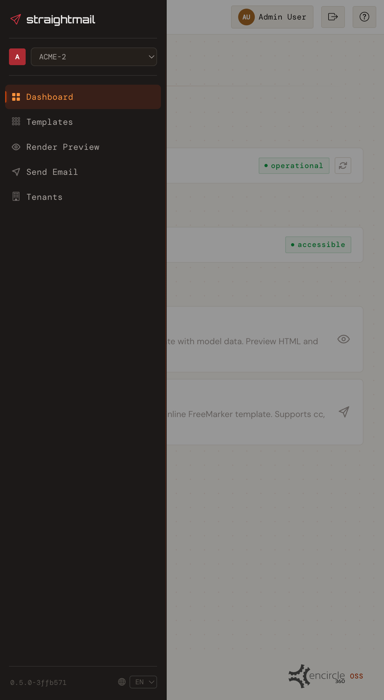
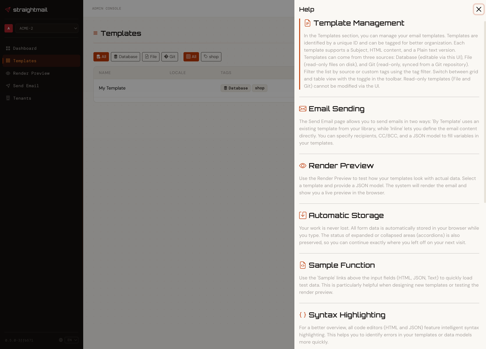
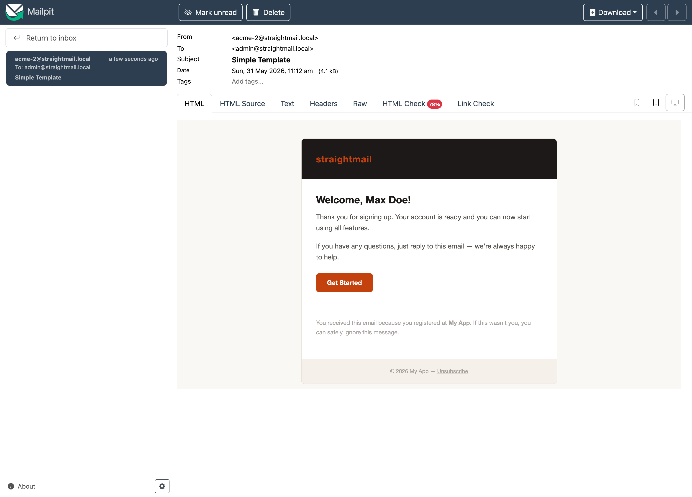

# StraightMail Admin Console

[](../../../actions/workflows/frontend.yml)
[](../LICENSE)
[](https://angular.io/)
[](https://www.typescriptlang.org/)
[](https://www.npmjs.com/)

A modern, open-source Angular administration console for managing email templates, rendering, and sending operations with the StraightMail email service.



<table width="800">
  <tr>
    <td valign="top" width="25%" align="center">
      
      <br><sub>Templates</sub>
    </td>
    <td valign="top" width="25%" align="center">
      
      <br><sub>Edit Template</sub>
    </td>
    <td valign="top" width="25%" align="center">
      
      <br><sub>Render Preview</sub>
    </td>
    <td valign="top" width="25%" rowspan="2" align="center" valign="top">
      
      <br><sub>Mobile View</sub>
    </td>
  </tr>
  <tr>
    <td valign="top" width="25%" align="center">
      
      <br><sub>Send Mail</sub>
    </td>
    <td valign="top" width="25%" align="center">
      
      <br><sub>Help Panel</sub>
    </td>
    <td valign="top" width="25%" align="center">
      
      <br><sub>Mail Output</sub>
    </td>
  </tr>
</table>

> ⚠️ **Alpha Stage Notice**: This project is currently in alpha stage and under active development. Features may be incomplete, and breaking changes may occur. Use in production environments at your own risk.

## ✨ Features

- 📧 **Email Template Management** - Create, edit, and delete email templates with HTML and plain text support, tag filtering, and pagination
- 🎨 **Template Rendering** - Preview rendered email templates with dynamic FreeMarker variable substitution (HTML + plain text)
- 📤 **Email Sending** - Send emails by template ID or inline template with dynamic recipients, CC/BCC, locale, and JSON model
- 🔐 **Authentication** - Follows the backend's `AUTH_MODE`: OpenID Connect (e.g. Keycloak) with silent token renewal and Bearer token injection, API key, or none
- 🏢 **Multi-Tenancy** - Tenant selector, tenant management and template CRUD when the backend runs with the `database` profile
- 📊 **API Health Dashboard** - Real-time API status monitoring with quick-action shortcuts
- 🌐 **Internationalization** - Full i18n support for English and German via ngx-translate
- 💾 **Persistent State** - Form inputs and application state persisted to localStorage via NGXS storage plugin
- 🎯 **Modern UI** - Responsive interface built with Bootstrap 5, ng-bootstrap, and custom Bootstrap Icons
- 🔧 **Developer Tools** - NGXS DevTools and logger plugins for easier debugging

## 🚀 Quick Start

### Prerequisites

- Node.js 22.22+, 24.15+ or 26 (`engines` in `package.json`)
- npm 12 (`packageManager: npm@12.2.3`)
- A running [StraightMail](../README.md) backend on `http://localhost:50003`; the dev server proxies `/api` to it

### Installation

```bash
# Clone the repository
git clone https://github.com/encircle360-oss/straightmail.git
cd straightmail/frontend

# Install dependencies
npm install

# Start the development server
npm start
```

The application will be available at `http://localhost:4200/`.

Before bootstrapping, the app reads its runtime configuration (`authMode`, `apiUrl`, `oidcAuthority`) from
`GET /api/v1/info`, so it uses whatever authentication mode the backend runs with. Start the backend with
`AUTH_MODE=none` to work without an identity provider.

## 📦 Available Scripts

| Command         | Description                         |
|-----------------|-------------------------------------|
| `npm start`     | Start development server            |
| `npm run build` | Build the project for production    |
| `npm run watch` | Build in watch mode for development |
| `npm test`      | Run unit tests with Vitest          |
| `npm run ng`    | Run Angular CLI commands            |

## 🏗️ Project Structure

```
frontend/
├── src/
│   ├── app/
│   │   ├── core/          # Guards, interceptors (bearer token, API key), API and auth services
│   │   ├── layout/        # Main shell (sidebar, topbar, footer)
│   │   ├── pages/         # dashboard, send, render, templates, tenants, api-key-login, unauthorized, not-found
│   │   ├── shared/        # Reusable components
│   │   └── store/         # Global NGXS states: auth, api-key, tenant, toast, ui
│   ├── environments/      # environment.ts (dev), environment.prod.ts, environment.e2e.ts
│   └── main.ts            # Loads /api/v1/info, then bootstraps the app
├── public/
│   ├── assets/i18n/       # Translation files (en.json, de.json)
│   └── logos/             # Brand assets
└── tests/                 # Playwright E2E tests
```

## 🛠️ Tech Stack

| Category                 | Technology                                         |
|--------------------------|----------------------------------------------------|
| **Framework**            | Angular 22.3                                       |
| **State Management**     | NGXS 22.0 (with devtools, logger, storage plugins) |
| **UI Library**           | Bootstrap 5.3 with ng-bootstrap 21                 |
| **Icons**                | Bootstrap Icons 1.13                               |
| **Internationalization** | ngx-translate 18.1                                 |
| **Authentication**       | angular-auth-oidc-client 22.0                      |
| **Language**             | TypeScript 6.0 (strict mode)                       |
| **Build Tool**           | Angular CLI with esbuild                           |
| **Testing**              | Vitest 5.1 with jsdom, Playwright 1.65 for E2E     |

## 🗄️ State Management

NGXS stores follow a **CQRS-inspired Command/Event pattern**:

- **Commands** express *intent* (e.g. `CreateTemplate`, `SendByTemplate`) and are dispatched by components
- **Events** report *outcome* (e.g. `CreateTemplateSuccess`, `SendFailed`) and are dispatched by the state handler after the API call completes

```
Component  →  dispatch(Command)
                 ↓
           State handler → API call
                              ↓ tap / catchError
                          dispatch([SuccessEvent | FailedEvent, ShowToast])
```

### Listening to events in components

Components must listen to **events**, not commands:

```typescript
// Correct — decoupled from state implementation
this.actions$.pipe(
  ofActionDispatched(TemplatesActions.CreateTemplateSuccess, TemplatesActions.UpdateTemplateSuccess),
  take(1),
).subscribe(() => this.router.navigate(['/templates']));

// Incorrect — couples component to command lifecycle
ofActionSuccessful(TemplatesActions.CreateTemplate)
```

### Available events per store

| Store       | Success events                                                                                    | Failure event         |
|-------------|---------------------------------------------------------------------------------------------------|-----------------------|
| `templates` | `CreateTemplateSuccess(template)`, `UpdateTemplateSuccess(template)`, `DeleteTemplateSuccess(id)` | `*Failed(error)`      |
| `send`      | `SendByTemplateSuccess`, `SendInlineSuccess`                                                      | `SendFailed(error)`   |
| `render`    | `RenderSuccess(result)`                                                                           | `RenderFailed(error)` |

All events are defined alongside their commands in the respective `*.actions.ts` file under `src/app/pages/*/store/`.

## 🔐 Authentication

The admin console uses the authentication mode the backend reports in `GET /api/v1/info`
(`AUTH_MODE` on the backend):

- **`oidc`** — `angular-auth-oidc-client` against the `oidcAuthority` from `/api/v1/info`, client ID
  `straightmail`, authorization code flow with silent renewal via refresh tokens. A guard redirects
  unauthenticated users to the provider, an interceptor attaches `Authorization: Bearer <token>`.
  Tested with **Keycloak**.
- **`api-key`** — the `/api-key-login` page asks for the key, an interceptor sends it as `X-API-KEY`.
- **`none`** — no login.

Bearer token and API key are only attached to requests for the API base on the console's own origin.
When `/api/v1/info` cannot be read, the defaults in `src/environments/` apply (`authMode: 'oidc'`,
`apiUrl: '/api'`).

### Keycloak Setup

1. Create a realm and a client with ID `straightmail`
2. Set **Valid redirect URIs** to your app's origin (e.g. `http://localhost:50003/*`, or `http://localhost:4200/*` for the dev server)
3. Enable **Standard flow** and **Refresh token** support
4. Set `OIDC_ISSUER_URI` on the backend to your realm URL; the console takes the authority from there

[`docker/keycloak/realm-export.json`](../docker/keycloak/realm-export.json) is a working example.

## 🔌 API Integration

The admin console calls the backend under `/api` (`apiUrl` from `/api/v1/info`):

| Method   | Endpoint                     | Description                                     |
|----------|------------------------------|-------------------------------------------------|
| `GET`    | `/v1/info`                   | Runtime configuration, API health check         |
| `GET`    | `/v1/status`                 | Template source and Git sync status             |
| `POST`   | `/v1/sync/git/{tenantSlug}`  | Trigger a Git sync for a tenant                 |
| `GET`    | `/v1/templates`              | List templates (paginated, optional tag filter) |
| `GET`    | `/v1/templates/{id}`         | Get a template                                  |
| `POST`   | `/v1/templates`              | Create a new template (`database` profile)      |
| `PUT`    | `/v1/templates/{id}`         | Update an existing template (`database` profile)|
| `DELETE` | `/v1/templates/{id}`         | Delete a template (`database` profile)          |
| `GET`    | `/v1/tenants/me`             | The caller's tenants                            |
| various  | `/v1/tenants[/{slug}]`       | Tenant management (admin, `database` profile for writes) |
| `POST`   | `/v1/email`                  | Send email by template ID                       |
| `POST`   | `/v1/email/inline`           | Send email with inline template                 |
| `POST`   | `/v1/render`                 | Render a template and return HTML/plain text    |

## 📄 Pages

### Dashboard

Displays the current API connection status (checking / up / down) and provides quick-action cards to navigate to Send and Render pages.

### Email Sending (`/send`)

Two send modes selectable via tabs:

- **By Template ID**: Select a stored template, optionally override the subject, and provide recipients and a JSON data model
- **Inline**: Provide a raw HTML/FreeMarker template directly in the form

Both modes support: multiple recipients, CC, BCC, locale selection (en, de, fr, es, it, pt), and a JSON model for variable substitution. Form state is persisted across page reloads.

### Template Rendering (`/render`)

Render a template by ID with a JSON model and preview the output in a modal with separate tabs for HTML (live preview) and plain text.

### Template Management (`/templates`)

Lists the templates of all sources; templates from the database (`database` profile) can be created,
edited and deleted, file and Git templates are read-only. Features:

- Paginated list (20 per page)
- Filter by tag
- Create / edit via modal dialog
- Delete & exit edit view with confirmation
- Fields: name, locale, tags, subject, HTML body, plain text body

## 🧪 Testing

```bash
npm test
```

Tests are written using Vitest with jsdom for DOM manipulation testing.

## 📝 Building for Production

```bash
npm run build
```

The production build will be output to the `dist/` directory with:

- Output hashing for cache busting
- Bundle size budgets (max 1MB initial, 8kB component styles)
- License extraction

## 🤝 Contributing

Contributions are welcome! Please feel free to submit a Pull Request.

1. Fork the repository
2. Create your feature branch (`git checkout -b feature/amazing-feature`)
3. Commit your changes (`git commit -m '✨ feat: add amazing feature'`)
4. Push to the branch (`git push origin feature/amazing-feature`)
5. Open a Pull Request

## 📄 License

This project is licensed under the Apache License 2.0 - see the [LICENSE](../LICENSE) file for details.

## 🙏 Acknowledgments

- Built with [Angular](https://angular.io/)
- State management by [NGXS](https://www.ngxs.io/)
- UI components from [ng-bootstrap](https://ng-bootstrap.github.io/)
- OIDC via [angular-auth-oidc-client](https://github.com/damienbod/angular-auth-oidc-client)

## 📧 Support

For issues and questions, please use the [GitHub Issues](../../../issues) page.

---

Made with ❤️ by encircle360 OSS
